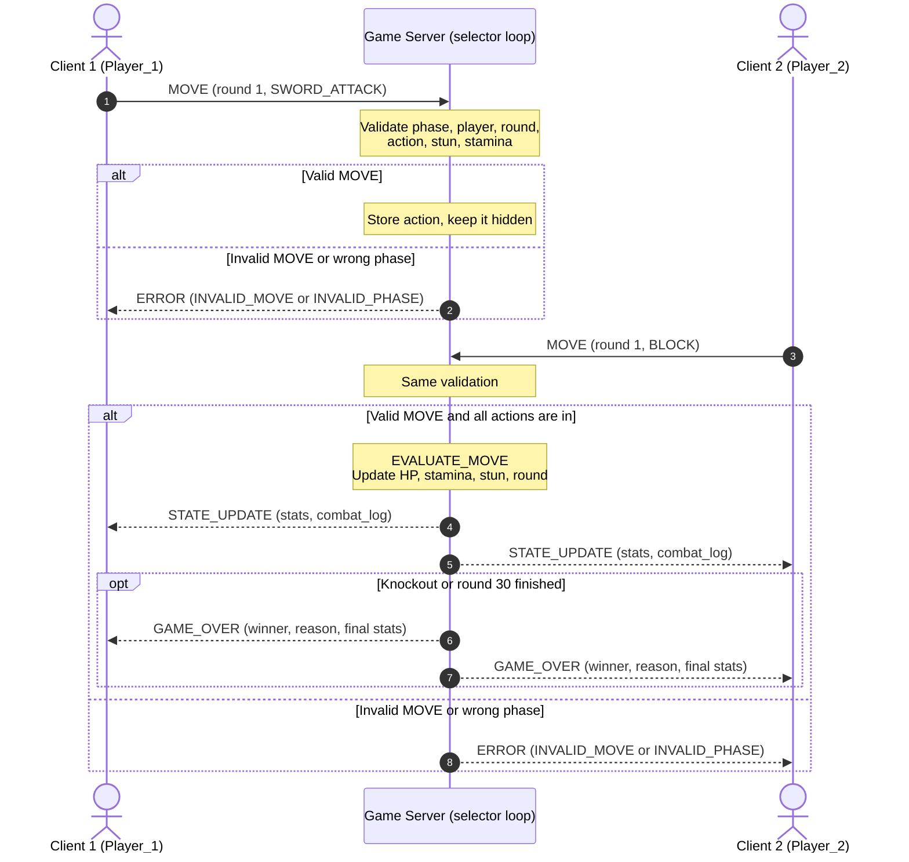

# Knight Duel: Concurrency Design

## 1. Concurrency Model

I chose **Option B: non-blocking I/O multiplexing with `selectors`**. The server is one thread running one event loop. The loop asks the operating system which sockets are ready to read or write, then handles them one at a time. There are no worker threads and no `threading.Lock`.

I picked this because my FSM says the server is the only thing that changes the game state, and only one match runs at a time. One thread doing one thing at a time fits that design, avoids race conditions, and makes the 120 second selection timer easy, since it is just the timeout passed to `select()`.

The listening socket and every client socket use `setblocking(False)`. For each client the server keeps a small connection record with its socket, an input buffer for partial JSON lines, an output buffer for unsent bytes, its player ID, and a `disconnected` flag.

## 2. Connection Lifecycle

1. **Listen:** At `INIT` the server binds and listens on its TCP socket, sets it to non-blocking, and registers it with the selector.
2. **Accept:** When the listening socket is readable, the server calls `accept()` and sets the new socket to non-blocking. If two players are already in, it sends `ROOM_FULL` and closes that socket.
3. **Register:** The new socket is registered with the selector and gets its own connection record.
4. **Join:** The client sends `CONNECT`. The server assigns `Player_1` or `Player_2`, and when the second player joins both clients receive `GAME_START`.
5. **Game loop:** The loop keeps reading from both sockets. Every complete line is parsed and handled. When all required `MOVE` messages are in, the server evaluates the round and sends `STATE_UPDATE` to both clients. A finished battle ends with `GAME_OVER`.
6. **Teardown:** A client is removed when it sends `DISCONNECT`, when `recv()` returns `b""` (EOF), when a socket error happens, or when it misses the 120 second deadline. The server sets the `disconnected` flag, unregisters and closes the socket, and discards its buffers. After the match, `CLEANUP` resets the server to `WAITING_FOR_PLAYERS`.

**Capacity:** Exactly two clients play at once, and one loop watches both of them. Neither client can block the server or the other player.

**Sending:** Because sockets are non-blocking, outgoing messages go into the output buffer and are sent with `send()`. Any leftover bytes are sent when the socket becomes writable. A socket that cannot send for 10 seconds is treated as disconnected.

## 3. Thread Safety and State Isolation

**Strategy: event-loop isolation.** There is only one thread, so two pieces of code never run at the same time. Each handler runs from start to finish before the next event is handled. Because of this, I do not use `threading.Lock`.

**Shared resources and why each is safe:**

- **Match state** (round, phase, Knight stats): only event handlers change it, one at a time.
- **Stored actions for the round:** storing a move and checking "are all actions in?" happen in the same handler, so nothing can slip in between.
- **Client socket list and player slots:** only the accept, `CONNECT`, and teardown handlers change them.
- **Input and output buffers:** each belongs to one connection and is only used by the loop.
- **`disconnected` flags:** checked and set inside one teardown function.
- **Round deadline:** only the loop reads and sets it.

**Places a race could happen, and why it does not:**

- **Both players send `MOVE` at once:** the selector reports both, but the loop handles them one after the other, so only one of them can be the last action.
- **`DISCONNECT` and timeout together:** they are handled one after the other. The first sets the `disconnected` flag, so the second does nothing and there is no double forfeit.
- **Evaluate and broadcast:** both happen inside one handler and nothing waits, so no `MOVE` can arrive halfway through.
- **Third client during a match:** accepting is its own event, and the server only sends `ROOM_FULL` to that socket.

**Rules that keep it safe:** never create threads, never block inside a handler (no `sleep()` or blocking `recv()`/`send()`), only let handlers change the match state, and send every departure through one teardown function that checks the `disconnected` flag first.

## 4. Turn and State Synchronization

Knight Duel is simultaneous, so both players choose during the same `PLAYER_TURN`. The server only broadcasts after the last required action arrives.

**How it works:**

1. A client sends `MOVE`, and the server validates it using the valid-move rules from the FSM.
2. An invalid or out-of-turn move (sent outside `PLAYER_TURN`, or a second `MOVE` in the same round) gets an `ERROR` sent only to the sender. The game state does not change.
3. A valid move is stored and hidden. Nothing is broadcast yet.
4. When the last required action arrives, the server evaluates the round and updates the match state.
5. The server sends `STATE_UPDATE` to both clients back-to-back in the same handler, so both get the same state before any other event is handled. If the battle ended, `GAME_OVER` follows.
6. If a player disconnects or times out, the other player gets `GAME_OVER` with reason `FORFEIT`.

## 5. Result and Score Synchronization

Knight Duel has no separate numeric score. The match state kept in server memory (round, HP, stamina, stun, and the winner and reason once decided) is the score. After every round it is broadcast to both clients in `STATE_UPDATE`, and the final result is sent in `GAME_OVER`. Clients only display what the server sends. `CLEANUP` resets everything for the next match.
